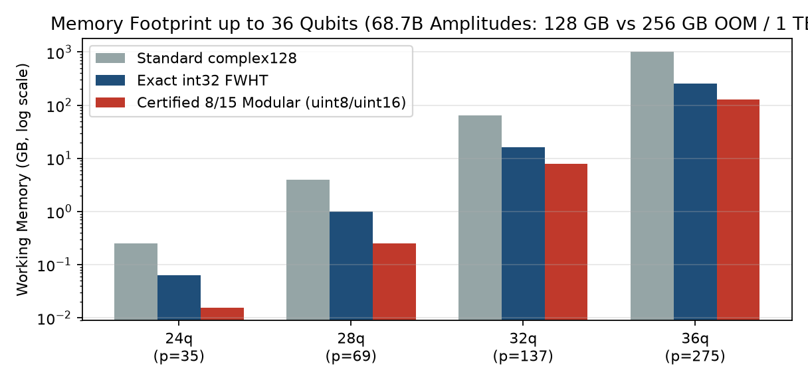
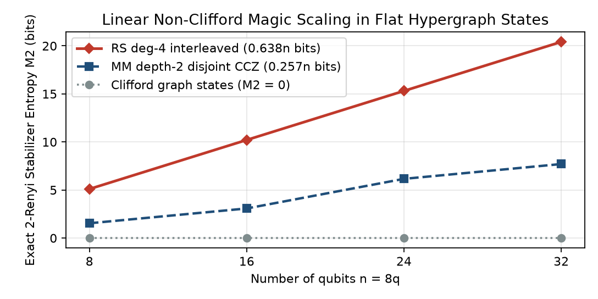
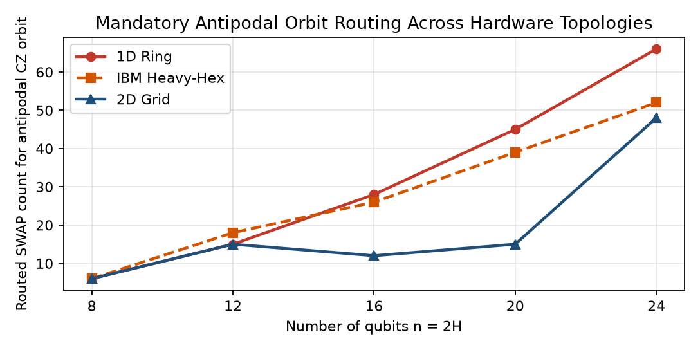

# Quantum Walsh Rigidity: Flat Non-Clifford Hypergraph States up to 36 Qubits

[](https://doi.org/10.6084/m9.figshare.35068705)
[](#license)

Reproducible code, OpenQASM 3.0 circuits, C/OpenMP 36-qubit verification engine, and LaTeX manuscript for:

> **Modular Walsh Rigidity and Antipodal Obstructions for Flat Non-Clifford Hypergraph States**  
> Filipe Martins Vono, André Oliveira Naufel de Toledo, Valéria Gonzaga Santos (2026)  
> Preprint: https://doi.org/10.6084/m9.figshare.35068705

Building on our Lean 4–certified antipodal necessity theorem ([DOI: 10.6084/m9.figshare.34165260.v2](https://doi.org/10.6084/m9.figshare.34165260.v2)) and modular Walsh rigidity at thresholds $8/15$ and $1/2$ ([DOI: 10.6084/m9.figshare.34963642.v4](https://doi.org/10.6084/m9.figshare.34963642.v4)).

---

## Key Results

### 1. Certified Flatness Verification up to **36 Qubits (68.7 Billion Amplitudes)**
Using overflow-free `uint8` / `uint16` modular Walsh–Hadamard transforms modulo $p \ge \frac{8}{15} 2^{n/4}$ (`src/fwht_omp.c`):

| Qubits ($n$) | Amplitudes ($2^n$) | Modulus $p_{8/15}$ | `complex128` RAM | Exact `int32` (Time / RAM) | Certified Modular (Time / RAM) | Speedup | Memory Reduction |
|---:|---:|---:|---:|---:|---:|---:|---:|
| **24** | $1.68 \times 10^7$ | $35$ | $0.25\,\text{GB}$ | `0.060 s` / `0.06 GB` | **`0.042 s` / `0.016 GB` (`uint8`)** | **1.43×** | **4× vs `int32` / 16× vs `c128`** |
| **28** | $2.68 \times 10^8$ | $69$ | $4.00\,\text{GB}$ | `1.131 s` / `1.00 GB` | **`0.770 s` / `0.250 GB` (`uint8`)** | **1.47×** | **4× vs `int32` / 16× vs `c128`** |
| **32** | $4.29 \times 10^9$ | $137$ | $64.0\,\text{GB}$ | `19.739 s` / `16.0 GB` | **`13.671 s` / `8.00 GB` (`uint16`)** | **1.44×** | **2× vs `int32` / 8× vs `c128`** |
| **36** | **$6.87 \times 10^{10}$** | **$275$** | **$1024\,\text{GB}$** | **OOM** (`256 GB`) | **`141.57 s` / `128.0 GB` (`uint16`)** | **Feasible** | **2× vs `int32` / 8× vs `c128`** |



### 2. Exact Linear Non-Clifford Magic ($M_2$) & Rotation-Symmetric Degree-4 Flat States
- **Dimensional Reduction Theorem:** $M_2(|\psi_f\rangle) = M_2(|\psi_g\rangle)$ for Maiorana–McFarland flat hypergraph states $f(x,y) = x\cdot y \oplus g(y)$, giving depth-2 states with $M_2 = \lfloor n/6 \rfloor \log_2(32/11) \approx 0.257\,n$ bits.
- **Rotation-Symmetric Degree-4 Family ($n = 8q$):** achieves **$M_2 = 0.638\,n$ bits** ($5.104$ bits on $n=8$, $10.207$ bits on $n=16$, certified at $p=9$ with 0 violations).



### 3. Antipodal Obstruction & Hardware Topology Routing
No rotation-symmetric $\{Z, CZ, CCZ\}$ circuit on $n=2H$ qubits can prepare a flat state without the full antipodal $CZ$ orbit $\{(i, i+H)\}$, imposing a lower bound of $\lceil H(H-1)/2 \rceil$ SWAPs on 1D rings.



---

## Repository Structure

- `paper/main.pdf` & `paper/main.tex` — full manuscript with 5 vector figures
- `src/hypergraph_walsh.py` — vectorized NumPy simulator, overflow-free `uint8`/`uint16` modular FWHT, exact $M_2$ calculator
- `src/fwht_omp.c` — multi-threaded C/OpenMP engine (benchmarked up to 36 qubits)
- `src/nisq_and_qasm.py` — OpenQASM 3.0 exporter & noisy finite-shot $X$-basis flatness testing
- `src/topology_compiler.py` — SWAP router for 1D Ring, 2D Grid, and IBM Heavy-Hex topologies
- `qasm/` — ready-to-run OpenQASM 3.0 circuits (`flat_cubic_n6.qasm`, `flat_quartic_n8.qasm`, `fooling_p3_n8.qasm`, `rs_quartic_flat_n8.qasm`, `rs_quartic_flat_n16.qasm`)
- `experiments/` & `results/` — reproducible experiment scripts and raw JSON logs

## Quickstart

```bash
# Python benchmarks (6 to 28 qubits, magic sweeps, NISQ noise, hardware routing)
python experiments/run_experiments.py
python experiments/run_pillars_1_2_3.py
python experiments/rs_quartic_bridge.py

# C/OpenMP multi-threaded engine (24, 28, 32, or 36 qubits)
gcc -O3 -march=native -fopenmp src/fwht_omp.c -o fwht_omp
./fwht_omp 28
```

## License

Code is released under the MIT License; manuscript and figures are released under CC BY 4.0.
